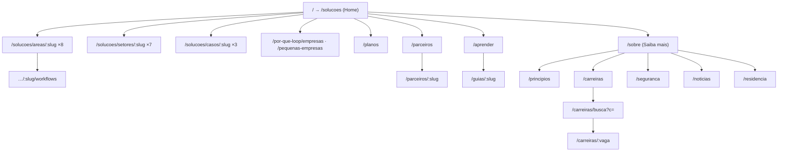

# Loop Consultoria — Site architecture (v0.1)

**Source of truth:** `data/site-map.json` (data-first). This document explains it.
**Reference:** structure of openai.com/solutions (home) and openai.com/about ("Saiba mais").
**Method:** 2 subagents scanned openai.com with WebSearch (Business area and Company area). The pages return HTTP 403 to automated reading; nobody bypassed it. Status per route: **Verified** = URL seen in search results · **Partial** = URL seen, sections from snippets only · **Inferred** = pattern, not seen.
**Rule:** we copy the information architecture only. Copy is lorem ipsum. Visuals use the Loop tokens. We MUST NOT copy the reference brand, illustrations or text.

## 1. Sitemap (MACRO)



| Menu | Link | Loop route | Reference pattern | Template | Status |
|---|---|---|---|---|---|
| Soluções | Visão geral | `/solucoes` | `/solutions/` | Home | Verified |
| Soluções | Áreas (8) | `/solucoes/areas/:slug` | `/business/solutions/{team}/` | Team | Partial (sales, finance) |
| Soluções | Workflows da área | `/solucoes/areas/:slug/workflows` | `/business/solutions/finance/workflows/` | Workflows | Verified |
| Soluções | Setores (7) | `/solucoes/setores/:slug` | `/solutions/industries/{x}/` | Industry | Partial (retail) |
| Soluções | Casos de uso (3) | `/solucoes/casos/:slug` | `/solutions/use-case/{x}/` | UseCase | Partial (agents, content) |
| Por que a Loop | Empresas · Pequenas empresas | `/por-que-loop/:segmento` | `/business/why-openai/{x}/` | Segment | Verified (URL) |
| Planos | — | `/planos` | `/business/pricing/` | Pricing | Verified (URL) |
| Parceiros | Ecossistema · Perfil | `/parceiros`, `/parceiros/:slug` | `/business/marketplace/`, `/business/partners/{x}/` | Directory, Profile | Verified (URL) |
| Aprender | Central · Guias | `/aprender`, `/guias/:slug` | `/business/learn/`, `/business/guides-and-resources/{x}` | Hub, Article | Verified (URL) |
| Empresa | Sobre | `/sobre` | `/about` | About | Partial |
| Empresa | Princípios | `/principios` | `/charter/` | Article | Verified (URL) |
| Empresa | Carreiras · Busca · Vaga | `/carreiras`, `/carreiras/busca`, `/carreiras/:vaga` | `/careers/`, `/careers/search?c=`, `/careers/{role}/` | Careers, JobSearch, JobPost | Verified (URL) |
| Empresa | Segurança | `/seguranca` | `/security` | Article | Inferred |
| Empresa | Notícias | `/noticias` | `/news` | Listing | Inferred |
| Empresa | Residência | `/residencia` | `/residency` | Program | Inferred |

Each link is a requirement: **WHEN the user activates the link, THEN the router MUST open the route in the table, AND the page MUST render its template.** `/` MUST redirect to `/solucoes`.

### Page templates (sections in order)
| Template | Sections | Evidence |
|---|---|---|
| Team | Hero + sales CTA · Capabilities (3) · Workflows link · Connectors · Customer result · FAQ · CtaBand | Snippets (sales, finance) |
| Workflows | Hero · Workflow areas (4) · Customer result · CtaBand | Snippet (finance) |
| Industry | Hero + "fale com o time do setor" · FeatureMedia ×3 · Customer quote · CtaBand | Snippet (retail) |
| UseCase | Hero · Product blocks (3) · Team examples (4) · CtaBand | Snippet (agents) |
| About | Mission · Structure · Company links (Princípios, Plano) · Careers teaser · CtaBand | Partial |
| Careers | Hero · Values · Job search (category filter) · CtaBand | Partial |
| Segment, Pricing, Directory, Profile, Hub, Program | see `data/site-map.json` | Inferred |

## 2. Home structure (MESO)

| # | Section | Component | Items | Ground |
|---|---|---|---|---|
| 1 | Header | Navbar (sticky) | logo, search, 2 menus, primary CTA | white, 85% + blur |
| 2 | Hero | Hero (centred) | title, subtitle, 2 CTAs | white |
| 3 | Áreas | CardGrid, 4 col | 8 IllustratedCard | white |
| 4 | Setores | CardGrid, 4 col | 8 IllustratedCard | white |
| 5 | Casos de uso | MediaCardRow, 3 col | 3 MediaCard | white |
| 6 | Confiança | SectionIntro (centred) | title, subtitle | white |
| 7 | Integrações | FeatureMedia | 1:1 media + title + body + CTA | blue-gray tint |
| 8 | Segurança | FeatureMedia | badges media + title + body + CTA | green tint |
| 9 | Final CTA | CtaBand | title + CTA | `surface` panel |
| 6b | Dados conectados | FeatureMedia | answers with cited sources | white |
| 10 | Footer | Footer | 3 link columns + legal | white |

## 3. Component inventory (MICRO)

| Component | Exists? | Anatomy | Loop tokens |
|---|---|---|---|
| Navbar | ✅ v0.1 | logo · search IconButton · 2 menus (DropdownMenu, bundle) · Button primary | `bg`, `text` |
| Hero | 🆕 | h1 · p · 2 Buttons (primary black, secondary `surface`) | `text`, `surface` |
| IllustratedCard | 🆕 | 1:1 media (tint ground + inner panel + label chip) · title · desc | `<tone>-tint`, `<tone>`, `radius-card` |
| CardGrid | 🆕 | section title + grid `repeat(auto-fit,minmax(240px,1fr))` | `space-6` |
| MediaCard | 🆕 | 1:1 media with floating UI mock · title · desc | `blue-tint`, `surface-raised` |
| SectionIntro | 🆕 | centred h2 + p, max 40ch | — |
| FeatureMedia | 🆕 | wide media (radius 24) · h3 · p · Button | tints |
| CtaBand | 🆕 | `surface` panel · h2 · Button | `surface` |
| StatTiles, TierDiagram, OrgCard, Toc, ArticleCard, NewsRow, Field, Accordion | ✅ | — | — |
| Timeline, JobList, StepFlow | 🆕 (About / Careers / UseCase) | — | — |

**Tone rotation for cards:** blue → purple → green → slate. The label chip is white with the tone's solid text colour (contrast ≥ 4.5:1). The label MUST repeat the card title, so colour is never the only cue.

## 4. Copy limits

| Slot | Max characters | Lines | Placeholder |
|---|---|---|---|
| hero.title | 48 | 2 | Lorem ipsum dolor sit amet consectetur |
| hero.subtitle | 110 | 2 | Lorem ipsum dolor sit amet, consectetur adipiscing elit sed do eiusmod tempor. |
| section.title | 32 | 1 | Lorem ipsum |
| card.label | 16 | 1 | Lorem |
| card.title | 28 | 1 | Lorem ipsum dolor |
| card.desc | 64 | 2 | Lorem ipsum dolor sit amet, consectetur. |
| feature.title | 52 | 2 | Lorem ipsum dolor sit amet integrações |
| feature.body | 96 | 2 | Lorem ipsum dolor sit amet. |
| cta.label | 22 | 1 | Fale com vendas |
| nav.item / footer.link | 16 / 24 | 1 | Lorem |

- Real copy MUST respect these limits. IF the text is longer, THEN the editor MUST shorten it; the layout MUST NOT truncate silently.
- CTA labels state the action (EARS ubiquitous): "The CTA label MUST start with a verb."

## 5. Layout limits

| Token | Value |
|---|---|
| Container max width | 1280px (text column 720px) |
| Side gutter | `clamp(16px, 4vw, 56px)` |
| Grid gap | 24px (cards), 40px (rows) |
| Section spacing | 120px desktop · 72px mobile |
| Breakpoints | 4 col ≥ 1100px · 2 col ≥ 640px · 1 col below |
| Media ratio | 1:1 cards · 16:10 feature |

## 6. Acceptance tests (Gherkin)

```gherkin
Scenario: Visitor opens an area from the home page
  GIVEN the home page shows the "Áreas" grid with 8 cards
  WHEN the visitor activates the card "Dados"
  THEN the browser opens "/areas/dados"
  AND the page shows the Solution template

Scenario: Keyboard visitor reaches every card
  GIVEN the visitor uses only the keyboard
  WHEN the visitor presses Tab through the home page
  THEN every card receives a visible focus ring in DOM order

Scenario: Narrow screen
  GIVEN a 320px viewport
  WHEN the home page loads
  THEN the grids show 1 column AND the page has no horizontal scroll
```

## 7. FMEA (top risks)

| Failure | Effect | Cause | Sev | Action |
|---|---|---|---|---|
| Card only identified by colour | Colour-blind users lose meaning | Tone without label | 4 | Label chip repeats the title |
| Copy exceeds limit | Broken grid | No content check | 3 | Lint `site-map.json` against `copyLimits` |
| Inferred routes differ from the reference | Wrong IA | Pages not read (403) | 3 | User confirms Segurança, Notícias, Residência, Planos layout |
| Media without alt | Screen-reader users miss content | Decorative/meaningful not set | 4 | `alt` required in data schema |
